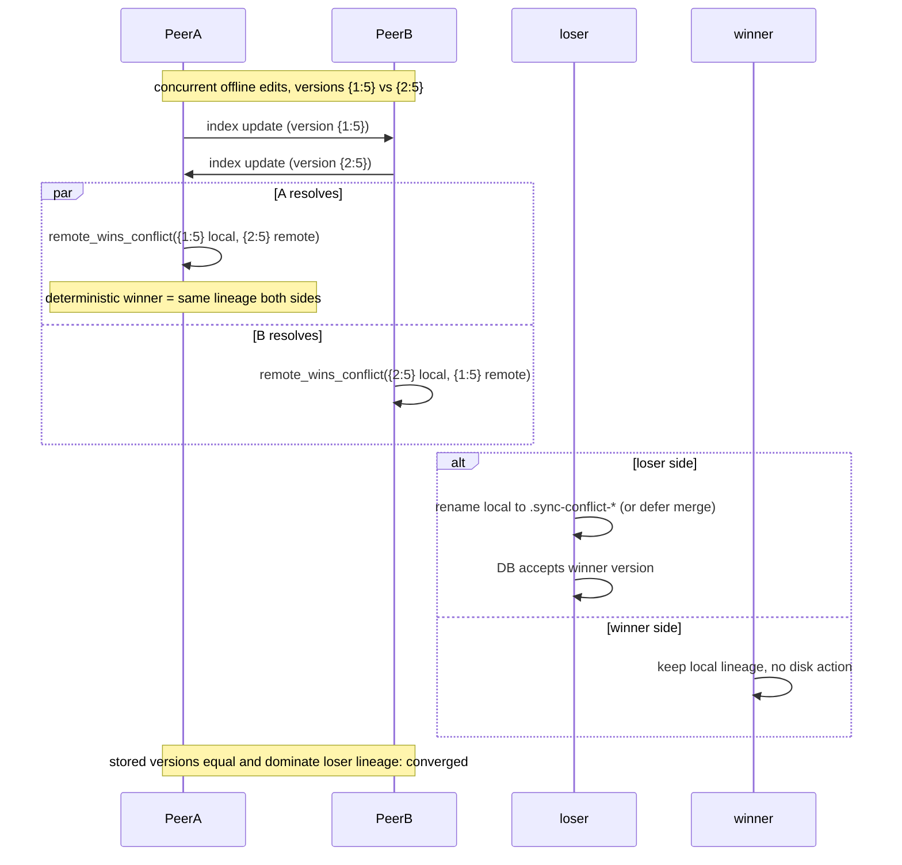

# ADR-20261105-09: 冲突确定性仲裁与单轮收敛

> English summary: Conflicts are resolved by a deterministic arbitration
> (newer mtime wins; mtime ties broken by the version vector's concurrent
> direction) aligned with Go Syncthing's `WinsConflict`, so both peers
> converge to the same winner within one index exchange without ping-pong
> loops; text-file merges are deferred to the Puller.

## 问题

双端离线并发修改同一文件时，版本向量并发（不可比较）。如果两端用
"各自保留本地"之类的非确定性策略解决，冲突永远不会收敛：A 删掉 B 的
版本、B 删掉 A 的版本，下一轮索引交换又产生同样的并发，形成无限回拉
循环（"死循环死亡证明"所针对的缺陷）。

## 备选方案

1. **各自保留本地（rename 双方）**：实现最简单，但冲突永不收敛，
   每次索引交换都重演，且两端目录里永远同时存在两个副本。
2. **先收索引者胜 / 后收者胜**：依赖消息时序，对网络重连、多路径
   发现敏感，不稳定。
3. **确定性仲裁，双端独立计算同一胜者**：对齐 Go Syncthing
   `FileInfo.WinsConflict`（bep_fileinfo.go）——mtime 新者胜；mtime
   相等时按版本向量的**并发方向**（首个分歧计数器）决胜。

## 决定

采用方案 3（`ConflictResolver::remote_wins_conflict`）：

- 规则：`(modified_s, modified_ns)` 大者胜；完全相等时
  `remote.version.concurrent_order(&local.version) == SelfGreater` 则远程胜。
- 胜者是**全局确定性函数**：两端对同一对 `(local, remote)` 输入（视角
  互换）计算出的胜者互为镜像，因此一次索引交换后两端存储同一胜出版本，
  该版本支配（dominates）败方谱系，冲突不再复发。
- 本地胜：不做任何磁盘动作，仅把本地版本写入 DB（远程版本天然被支配）。
- 远程胜：
  - 可合并文本 → 先接受远程版本入 DB，**文本三路合并推迟到 Puller**
    下载完成后用 `base_version` 执行（`conflict_resolver.rs` 的
    `resolve_conflict` 直接返回 `UseRemote`，由 `puller::download_file`
    完成合并并回写 `base_version`）。
  - 其他文件 → 本地副本改名留证
    `name.sync-conflict-<timestamp>-<device short ID>.ext`（与 Go 命名
    对齐，跨实现可识别），DB 接受远程版本。

## 理由

确定性仲裁把"冲突解决"从时序问题变成纯函数求值，是双端收敛的必要
条件；与 Go 对齐保证与官方实现的互操作行为一致（冲突文件名、胜者
判定）。合并推迟到 Puller 是因为合并需要远程内容落盘后的
`base_version` 三方对比，在索引处理阶段远程块尚未传输。
