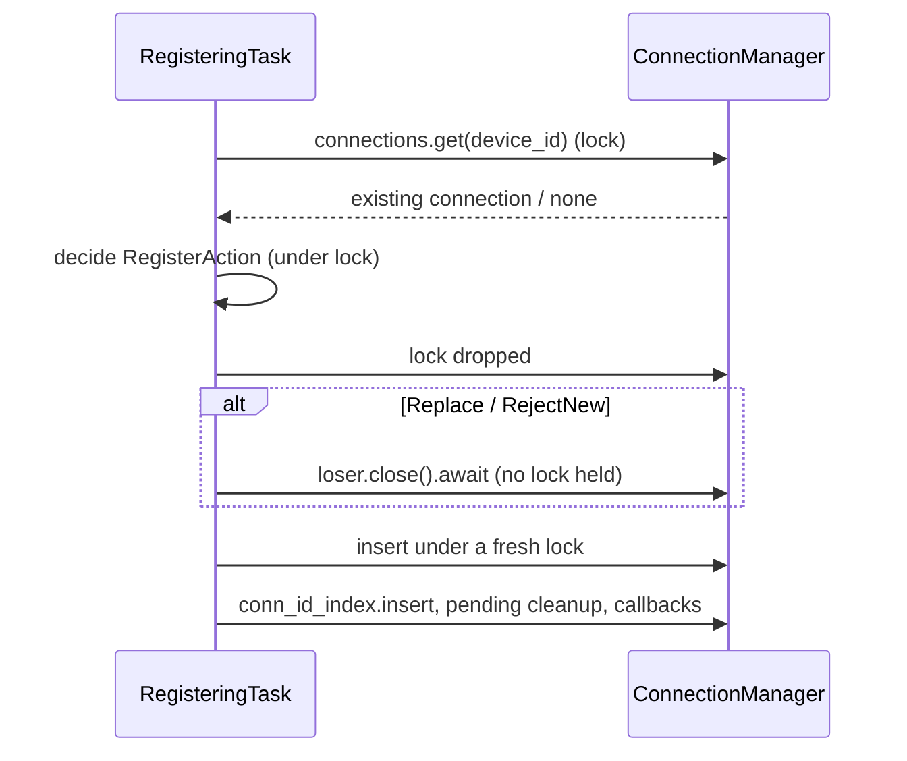

# ADR-20261105-connection-race：同时拨号竞争解决

> English summary: When both ends dial each other simultaneously, each side
> ends up with an incoming and an outgoing connection. This ADR fixes the
> resolution rule (smaller device ID keeps incoming / larger keeps outgoing,
> consistent with Go Syncthing), moves the decision before the BEP Hello to
> avoid useless handshakes, adds a deterministic quiet-period yield before
> TLS ClientHello, replaces existing connections on new handshakes, and
> requires all DashMap decisions to be taken under the lock with all `.await`
> I/O performed after releasing it (deadlock prevention).

## 问题

Syncthing 两端可能同时拨号（例如同一时刻 scheduled reconnect 与对端
incoming 并发）。若不做裁决，每条物理连接上都会跑一遍完整的
TLS + BEP Hello + ClusterConfig，且双方各自保留不同的连接，导致
索引在两条连接上分裂、心跳互相干扰。

## 竞争规则（与 Go Syncthing 一致）

- device ID **较小**的一方保留 **incoming** 连接，关闭 outgoing；
- device ID **较大**的一方保留 **outgoing** 连接，关闭 incoming。

这样两端最终保留的是**同一条**物理连接。同类型重复握手（同方向第二次
握手）先开始者获胜。

判定矩阵（local 视角，`local_smaller = local_device_id < remote`）：

| 已有（旧） | 新到 | 裁决 |
|:---|:---|:---|
| incoming | outgoing | local 较小 → 旧 incoming 胜 |
| outgoing | incoming | local 较大 → 旧 outgoing 胜 |
| 同类型 | 同类型 | 先开始者胜 |

## 决定 1：裁决提前到 BEP Hello 之前

`begin_handshake` 在 TLS 握手完成后、BEP Hello 之前注册
`pending_handshakes` 并立即裁决；失败方直接关闭 socket，不再进行无效的
Hello 交换。拨号侧（outgoing）在发送 TLS ClientHello 之前也先注册握手
状态——若本端按规则应保留 incoming，则直接放弃本次 outgoing 拨号。

时序（两端同时拨号，local ID < remote ID）：

```mermaid
sequenceDiagram
    participant L as LocalDevice(smaller ID)
    participant R as RemoteDevice(larger ID)
    L->>R: TLS ClientHello (after quiet-period yield)
    R->>L: TLS ClientHello
    Note over L,R: Both complete TLS; each begins_handshake()
    L->>L: begin_handshake(Incoming): wins, keeps incoming
    L->>L: begin_handshake(Outgoing): race lost, aborts outgoing dial
    R->>R: begin_handshake(Outgoing): wins, keeps outgoing
    R->>R: begin_handshake(Incoming): race lost, closes incoming socket
    L->>R: BEP Hello (on the single surviving connection)
    R->>L: BEP Hello
```

源码：`crates/syncthing-net/src/manager/handshake.rs`。

## 决定 2：outgoing 前的静默期退让

两端同时发起 TLS ClientHello 本身没有危害（裁决会兜底），但会产生一次
必然失败的握手。为降低其概率：当本端 device ID 较小（即"应当输掉
outgoing"的一方）时，在发送 ClientHello 前等待一段 **50–250 ms** 的
确定性伪随机延迟——

- 延迟由双方 device ID 的 `DefaultHasher` 哈希导出，两端各自独立计算出
  同一个值；
- 50–250 ms 足以覆盖局域网/同地区 relay 的 RTT，又不让首次连接显得明显
  迟缓；
- 不用 `rand::thread_rng()`：它跨 await 会使 future 非 Send。

设备 ID 较大的一方不做退让（它是 outgoing 的合法赢家，先发起无妨）。

## 决定 3：新握手无条件顶替已有连接

`begin_handshake` 遇到"该设备已有连接"时不拒绝：新握手到达通常意味着
对端重启、旧条目是尚未被清理的僵尸（socket 已死但注册表还在），拒绝会
让双方永远无法重连。行为与 Go Syncthing 一致——新连接顶替旧连接。

`ponytail:` 这是"新连接无条件获胜"的简化；升级路径是按 Go 的连接
优先级（传输类型、device ID 比较）仲裁保留哪条。

## 决定 4：注册阶段锁内决策、锁外 I/O

`register_connection` 先用 `RegisterAction` 枚举在 DashMap 锁内完成裁决
（Replace / RejectNew / InsertExisting / CreateNew），释放锁后再执行
`close().await` 等 I/O。DashMap 内部是 `parking_lot::RwLock`，跨 `.await`
持锁会阻塞同 shard 的其他任务，连接风暴时可能耗尽所有 tokio worker
（T-F1 修复）。

时序：



源码：`crates/syncthing-net/src/manager/registry.rs`。

## 理由

- 与 Go Syncthing 逐条对齐保证线行为一致（双方保留同一条连接）；
- 裁决前置消除无效握手开销与 session 空等（10s ClusterConfig 超时）；
- 锁外 I/O 是 Rust 异步 + 同步锁混合使用的硬约束，违反即死锁。

## 补充：session 句柄移除不得 abort（cmd/syncthing 侧，2026-11-05）

`cmd/syncthing/src/tui/daemon_runner.rs` 的 `on_disconnected` 回调只从
`session_handles` 移除旧句柄，**不调用 `abort()`**。

原因：race resolution 替换连接时，`on_connected`（启动新 BepSession）
与 `on_disconnected`（旧连接关闭回调）的到达顺序不保证。若
`on_disconnected` 晚到并 abort 句柄，会误杀新连接上的 session。
旧 session 在连接关闭后会自己从 recv/send 错误退出，无需外部 abort。
