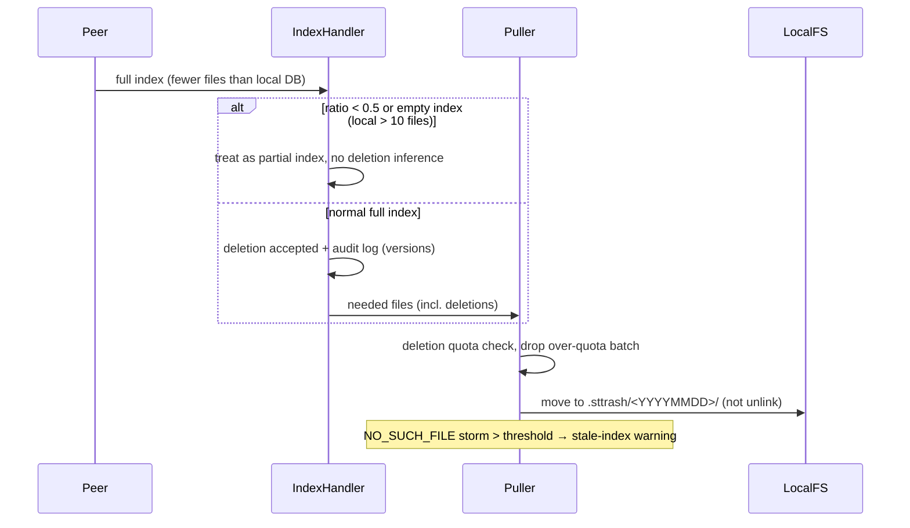

# ADR-20261105-10: 远程删除防线（索引侧 + 拉取侧）

> English summary: Multiple independent guards prevent a stale/corrupt peer
> index from mass-deleting local data: an index-size ratio threshold, empty-
> index rejection, no deletion markers for never-known files, a per-pull
> deletion quota (see ADR-20261105-pull-delete-quota), quarantining deleted
> files into `.sttrash` instead of unlinking, and traceable deletion audit
> logs.

## 问题

对端被格式化/重装、或索引损坏时，可能下发"大量文件已删除"的语义。
若无防护，本地会跟随删除并广播，形成 §15 级联删除——2026-07-20 事故
中 114 个文件经增量批次被删。需要在索引处理与拉取两个层面设防。

## 索引处理侧防线（`index_handler.rs`）

1. **质量阈值**（`MASS_DELETION_SAFETY_RATIO = 0.5`）：对端全量索引的
   文件数低于本地 DB 的 50%（且本地 > 10 个文件）时，拒绝把"本地有、
   对端无"解释为删除，按部分索引处理。防止格式化/重装的对端触发批量
   误删。
2. **空索引拒绝**：对端发送空 Index（文件数为 0）而本地 > 10 个文件时，
   同样拒绝全量语义。空索引是危险信号。
3. **未知文件不持久化删除标记**：远程删除一个本地从未有过的文件时，
   不把删除标记写入 DB。否则本地 scanner 会把它当成"本地文件被删除"，
   向上游（包括发送该删除的对端）推送 IndexUpdate，触发 §15 级联删除。
4. **删除审计**：远程删除被接受时，以结构化日志记录文件名、对端与
   双端版本向量摘要（`{1:10,2:6}` 形式），保证事后可溯源（2026-07-20
   事故的教训：当时无法回答"谁删的、依据什么版本"）。

## 拉取侧防线（`puller/mod.rs`）

5. **删除配额**：单次 pull 的远程删除数超过 `max(PULL_DELETE_QUOTA_MIN,
   本地文件数 × PULL_DELETE_QUOTA_RATIO)` 时丢弃整个删除批次（下载/修改
   不受影响）。论证见 `ADR-20261105-pull-delete-quota.md`。
6. **软删除（.sttrash 隔离）**：远程驱动的删除不直接 unlink，而是移入
   `<folder>/.sttrash/<YYYYMMDD>/`（重名追加时间戳）。对端索引损坏时
   本地数据仍可恢复——2026-07-20 事故的零兜底（versioning 未配置时
   数据彻底丢失）。
7. **过期回收站清理**：每次 pull 顺带清理 `.sttrash` 中超过 7 天保留期
   的日期目录（按目录名日期判断，不递归检查内容；清理失败仅告警）。
8. **陈旧索引健康告警**：单次 pull 中 BEP error code 2（NO_SUCH_FILE）
   响应超过 `STALE_INDEX_WARN_THRESHOLD` 时输出健康告警（详见删除配额
   ADR）。

## 理由

各防线覆盖不同攻击/故障面：质量阈值与空索引拒绝挡"对端状态异常"，
未知文件不持久化挡"级联放大"，删除配额挡"增量批次的慢速清空"（全量
阈值覆盖不到的场景，2026-07-20 的 114 文件正是经增量批次），.sttrash
软删除保证任何情况下可恢复，审计日志保证可溯源。它们互相独立、不可
互相替代。
