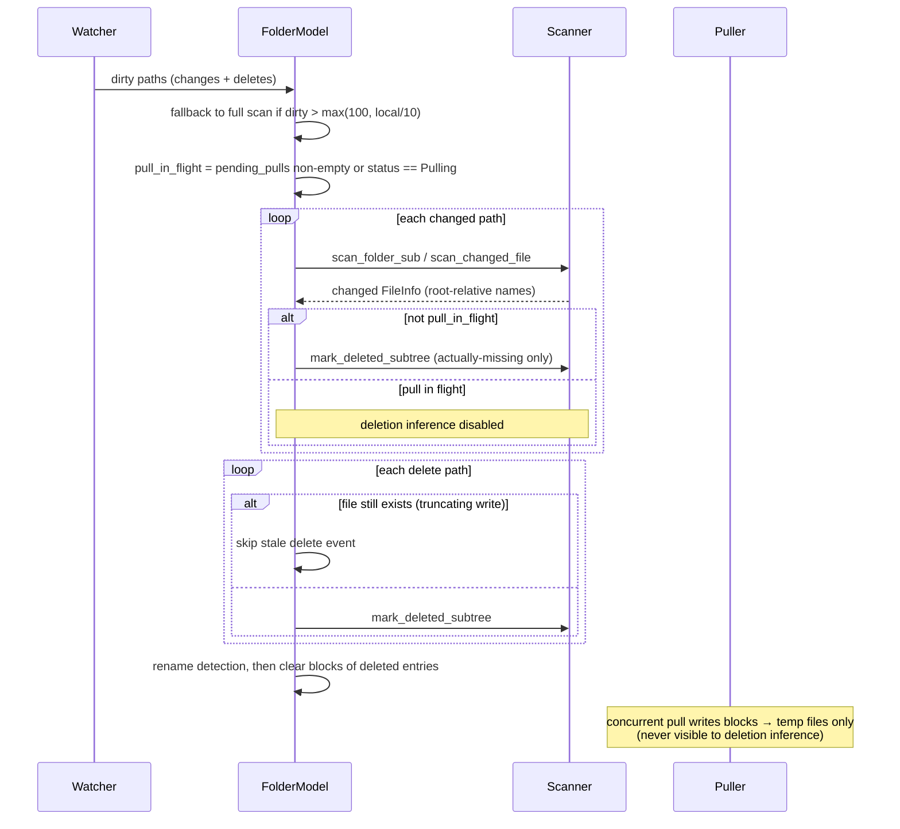

# ADR-20261105-11: Scanner 增量路径正确性规则

> English summary: Watcher-driven incremental paths follow a set of
> correctness rules that full scans get for free: metadata directories are
> excluded at every incremental entry point, ignore rules are matched against
> ancestor directories, sub-scan index names stay relative to the folder root,
> deletion inference is disabled while a pull is in flight, stale remove
> events from truncating writes are skipped, and deleted entries keep their
> block lists until rename detection finishes.

## 问题

全量扫描是一次干净的自洽遍历；watcher 驱动的增量路径（单文件变更、
子树扫描、删除标记）只触及目录树的局部，若不补齐全量遍历隐含的约束，
就会产生四类历史缺陷：

1. **归档↔同步反馈循环**：versioner 写 `.stversions` 触发 watcher →
   增量扫描把归档文件索引出去 → 对端同步这些归档 → 又触发对端 watcher
   （watcher 增量的逐条目文件名过滤拦不住，因为归档文件名不含被排除名）。
2. **被忽略目录内的文件漏判**：`IgnoreMatcher::matches` 对目录规则
   （`dir/`）只在 `is_dir = true` 时生效，而 watcher 传入的是文件路径；
   只判文件本身会让被忽略目录内的新增/修改被索引并同步出去
   （docs/KNOWN_ISSUES.md §23）。
3. **子扫描路径基准错位**：watcher 以变动子目录为扫描根，若索引名以
   扫描根为基准，`subdir/hello.md` 会被记成 `hello.md`，对端按错误路径
   请求块而报 InvalidFile（W16）。
4. **删除推断与在途拉取的竞态**：远程索引到达后 DB 记录先于块传输
   落盘；此窗口内按"DB 有记录但磁盘无文件"推断删除，会把正在传输的
   文件标记为删除并广播新版本，对端据此把唯一副本移入 `.sttrash`，
   文件从此无法同步（2026-10-16 e2e_crud `kept/public.txt` 实测链路：
   pull 创建 `kept` 目录 → watcher 触发子树扫描 → `mark_deleted_subtree`
   误删）。

## 决定（规则全集）

1. **元数据目录入口拒绝**：`is_default_ignored_path` 拦截
   `scan_changed_file` / `mark_deleted_subtree` / 子扫描根三条增量路径；
   子扫描根落在 `.stversions` 等目录时入口直接返回空（全量扫描的逐条目
   过滤仍保留，作为兜底）。
2. **祖先级 ignore 匹配**：`is_ignored_with_ancestors` 对文件路径逐级
   检查祖先目录（祖先一律按目录判断）；子扫描根也过这道检查。
3. **索引名始终以 folder 根为基准**：`scan_directory` 的
   `relative_prefix` 随递归逐层累加，避免 `Path::strip_prefix` 在 Windows
   UNC/混合分隔符下的平台差异。
4. **在途拉取时禁用删除推断**：`pull_in_flight = pending_pulls 非空 ||
   状态为 Pulling`；为真时增量扫描跳过 `mark_deleted_subtree`。
5. **只标记磁盘上确实消失的文件**：`mark_deleted_subtree` 对仍存在
   的条目一律跳过，否则同步后整棵子树被移入 `.sttrash`（W16 根因之二）。
6. **幻影删除防护**：watcher 对截断覆写（shell `>`、编辑器保存）上报
   remove+create，同一路径同时出现在 changes 与 deletes；文件仍存在时
   删除事件视为陈旧并跳过，否则删除记录会盖掉刚扫到的新版本并广播。
7. **重命名检测的 blocks 生命周期**：删除条目先保留 blocks 供
   `detect_and_reorder_renames` 做哈希匹配，检测完成后统一清空（BEP
   要求删除条目的 block list 为空）；匹配成功的新文件排在变更列表最前，
   使接收端先创建新文件（可从旧文件复制内容）再删除旧文件。
8. **零字节文件的 BEP 兼容**：零字节文件也必须携带一个 block，hash 为
   `SHA256("")`，否则 Syncthing-Fork 等客户端报 "file with empty block
   list" 并主动断开。

## 理由

增量路径的每一条规则都对应一次实测事故（反馈循环、§23、W16、
2026-10-16 竞态），属于"拿不准就保留"级的正确性约束。规则 4 是项目
硬红线（"索引/删除推断与在途拉取有竞态"）的直接落地；规则 5、6 是
规则 4 之外第二道、第三道防误删闸。
