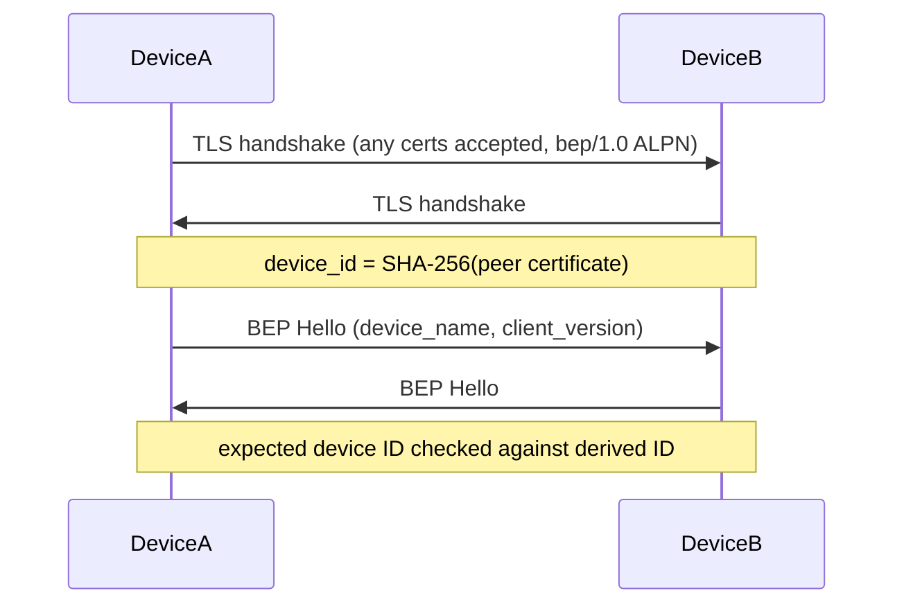

# ADR-20261105-tls-device-auth：TLS 层不验证书，设备认证在 BEP 层

> English summary: Syncthing uses TLS only as an encrypted tunnel. Both
> client and server verifiers accept any certificate (no chain validation),
> while device authentication happens at the BEP protocol layer: the device
> ID is the SHA-256 hash of the peer certificate's public key, extracted
> after the handshake and matched against the expected ID. This mirrors the
> Go implementation's self-signed certificate model.

## 问题

Syncthing 的设备身份绑定自签名证书（无 CA、无证书链）。标准 TLS 证书
验证（链校验、hostname 校验）在此模型下无法工作，但传输仍需机密性与
完整性保护。

## 决定

TLS 层**接受任意对端证书**，仅提供加密隧道：

- 服务端（`SyncthingClientCertVerifier`）：`verify_client_cert` 恒返回
  `ClientCertVerified::assertion()`；
- 客户端（`SyncthingCertVerifier`）：`verify_server_cert` 恒返回
  `ServerCertVerified::assertion()`，不校验证书链与 hostname（server name
  固定为 `"syncthing"`）；
- 两侧 `supported_verify_schemes` 列出 Ed25519 / ECDSA P-256/P-384 /
  RSA 系算法，覆盖 Go 实现支持的密钥类型。

设备认证上移到 BEP 层，流程：

- 入站：`accept_tls_stream` 从对端证书派生 device ID
  （`SyncthingTlsConfig::derive_device_id`，SHA-256 of certificate DER），
  供连接管理器裁决与注册；
- 出站：`connect_tls_stream` 派生对端 device ID 并与期望 ID 比较，
  不匹配即失败（device ID mismatch）。

ALPN 区分用途：`bep/1.0`（BEP 数据连接）、`bep-relay`（Relay Protocol
信令连接，另见 relay 模块的 Protocol/Session 双模式）。

## 备选方案

| 方案 | 否决理由 |
|:---|:---|
| 自建 CA + 证书签发 | 与 Go Syncthing 不互通；引入 CA 运维负担 |
| 标准 WebPKI 证书 | 设备无域名，且与 Go 实现的线行为不一致 |
| TLS 层完整校验 + 指纹白名单 | 等价于本方案但校验逻辑重复，rustls 自定义 verifier 更直白 |

## 理由

与 Go 实现逐字节线兼容（互操作是硬约束）；自签名模型下"证书即身份"，
SHA-256(证书) 天然不可伪造且无需信任第三方；验证逻辑集中在一个派生
函数上，审计面最小。
