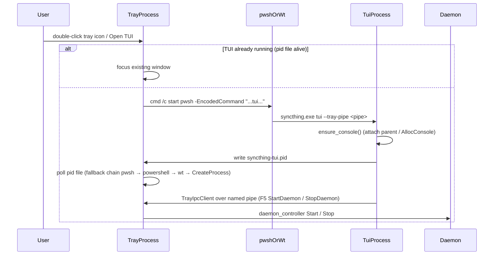

# ADR-20261105-windows-tui-launch：托盘启动 TUI 的控制台与终端策略

> English summary: The release binary is built with
> `windows_subsystem = "windows"` (no console), so every code path that needs
> a terminal must acquire one explicitly. `ensure_console()` attaches to the
> parent console when present (TUI renders in the launching terminal) and
> falls back to `AllocConsole()`. `spawn_tui_from_tray()` launches the TUI
> through an ordered fallback chain — PowerShell 7, Windows PowerShell,
> Windows Terminal, bare CreateProcess — where terminal programs are invoked
> via `cmd /c start` (CREATE_NO_WINDOW so cmd itself does not flash a console)
> because only `cmd.exe` resolves Microsoft Store AppExecutionAlias binaries;
> the final CreateProcess fallback uses CREATE_NEW_CONSOLE so the child gets
> its own console. Every strategy verifies success by polling the
> `syncthing-tui.pid` file, because `cmd /c start` returns success even when
> the target program does not exist. The TUI runs under a `tokio::task::LocalSet`
> because crossterm keeps raw-mode state in thread-locals on Windows.

## 问题

发行构建是 `windows_subsystem = "windows"`（无控制台、无终端窗口），但
托盘需要能打开 TUI，TUI 需要渲染在某个终端窗口里。直接用
`std::process::Command` 启动 `pwsh.exe` / `wt.exe` 会遇到三个问题：

1. Store 安装的 `pwsh.exe` / `wt.exe` 是 AppExecutionAlias 重解析点，
   `CreateProcessW` 找不到这些文件；
2. 托盘进程没有控制台，启动 `cmd.exe` 会先弹一个黑色控制台窗口再执行
   `start`；
3. `cmd /c start` 即使目标程序不存在也返回成功，无法区分"终端启动了
   但 syncthing 没跑"与"终端程序根本不存在"。

另外 `syncthing tui` 直接运行时，crossterm 在 Windows 下把 raw mode
状态放在 thread-local 里，tokio 把 future 调度到别的线程会丢状态。

## 决定

1. **控制台获取**（`ensure_console`，TUI 进程内）：
   - 已有控制台（`GetConsoleWindow` 有效）→ 直接返回；
   - 否则 `AttachConsole(ATTACH_PARENT_PROCESS)`，成功则 TUI 渲染在启动
     它的终端标签页（托盘场景父进程是专门的 pwsh/wt；直接终端运行则
     正好复用当前标签页）；
   - 否则 `AllocConsole()` 创建独立控制台窗口。
2. **四档拉起链**（`spawn_tui_from_tray`，按序回退）：
   - `pwsh.exe -EncodedCommand "Clear-Host; & '<exe>' tui ..."`：PowerShell
     直接执行并阻塞，TUI 作为子进程接管整个终端窗口，避免与父 shell
     竞争控制台输入/输出；
   - `powershell.exe`（Windows PowerShell，同样的 EncodedCommand）；
   - `wt.exe new-tab --title ... -- <exe> tui ...`（不经过 PowerShell 中间层）；
   - 裸 `CreateProcess` + `CREATE_NEW_CONSOLE`（最快、无 shell 闪烁，
     但失去终端模拟器特性）。
   前两条与 wt 都经 `cmd /c start` 调用并带 `CREATE_NO_WINDOW`（cmd 在
   后台执行，只保留目标终端窗口）。
3. **成功判定**：每种策略启动后轮询 `syncthing-tui.pid` 是否出现且进程
   存活（100ms × 50 次；冷启动 Windows Terminal 需 2~3 秒），失败才回退
   下一档。已有 TUI 实例（pid 文件存活）时聚焦其窗口而非重复创建。
4. **LocalSet**：`run_tui_mode` 用 `tokio::task::LocalSet` 把 TUI 固定在
   当前 OS 线程，保住 crossterm 的 raw-mode thread-local 状态。
5. **TUI 日志双写**：crossterm 接管 stdout，因此 TUI 日志同时写文件
   （固定 DEBUG，便于诊断布局/启动问题）和内存缓冲区（按用户级别过滤，
   供 TUI 日志视图消费）。

## 时序

见 `docs/design/sequence/tray-tui-daemon.md`（同一份图内嵌于本文末尾）。

## 理由

- AppExecutionAlias 是 Store 分发终端的现实约束，`cmd /c start` 是
  官方支持的解析路径；
- pid 文件轮询把"命令返回成功"与"程序真实启动"解耦，避免误判后同时
  打开两个终端；
- 附加父控制台优于总是 `AllocConsole()`：用户在哪个终端发起，TUI 就
  出现在哪个终端，不产生多余窗口。
