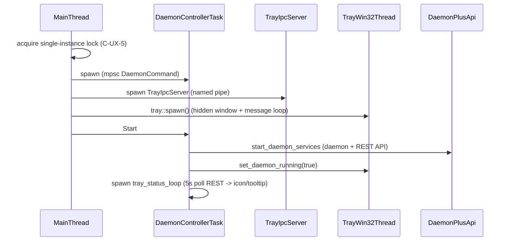
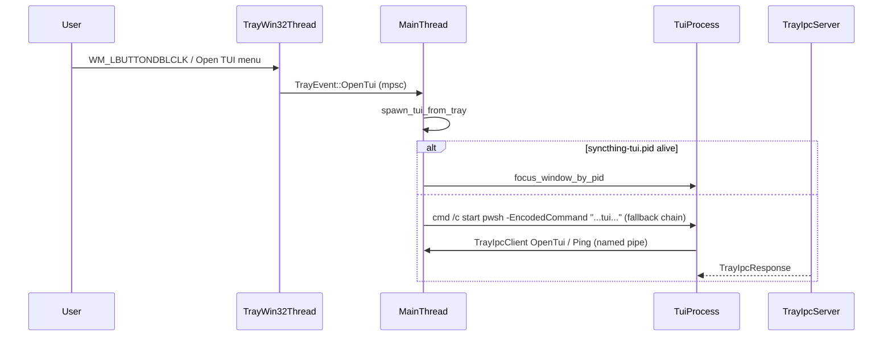
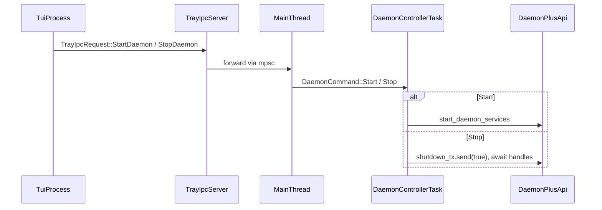

# Tray ↔ TUI ↔ Daemon interaction sequence

> Source of truth for the tray/TUI/daemon choreography referenced by
> `docs/design/ADR-20261105-windows-tui-launch.md`. Keep in sync with
> `cmd/syncthing/src/main.rs` (Auto mode, daemon_controller, tray helpers) and
> `cmd/syncthing/src/tray_ipc.rs`.

## Auto-mode startup

## Open TUI from tray

## F5 daemon toggle (tray-managed TUI)

